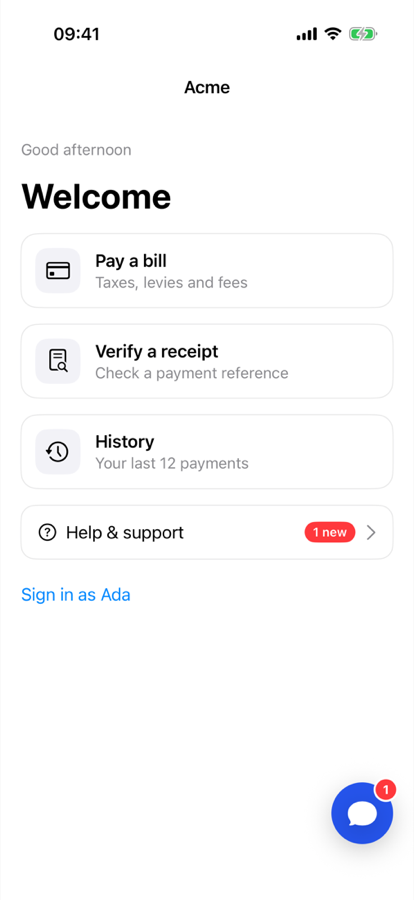
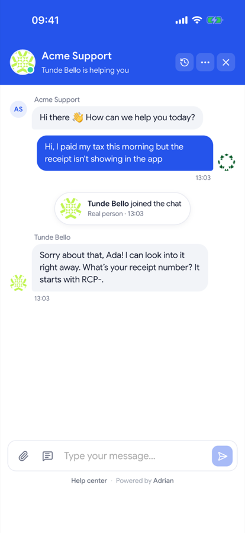
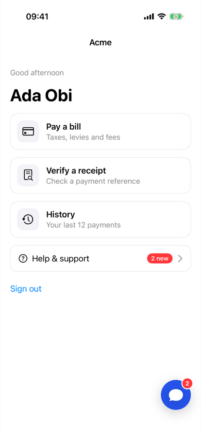
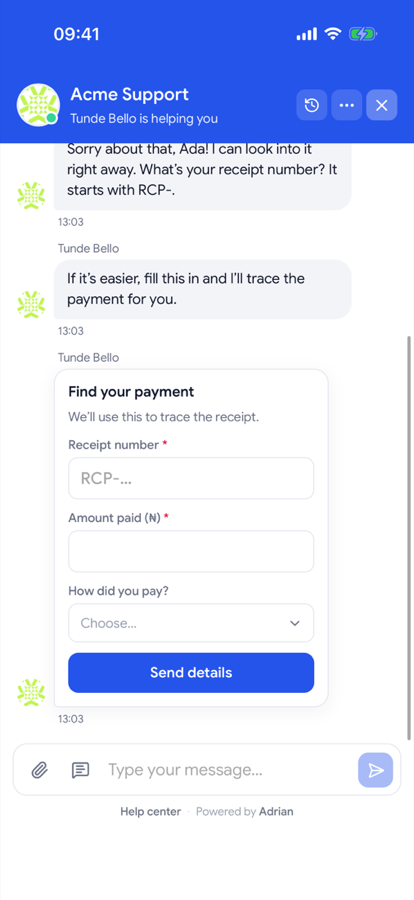

# AdrianChat for iOS

[Adrian](https://adrianhq.co) live chat for iOS 15+ apps, in SwiftUI and UIKit.

The package opens your workspace's chat full screen in your brand colour. Customers get everything they have on your website: forms, action buttons, chat flows, file uploads, ratings, help center search and the AI agent. It also gives you a launcher button with an unread badge, and the unread count to show anywhere else in your app.

<p>
  
  
  
  
</p>

## Features

- Full-screen messenger that follows your workspace's widget settings: colours, greeting, conversation starters and business hours.
- `AdrianLauncher` (SwiftUI) and `AdrianLauncherButton` (UIKit): a round chat button with an unread badge.
- `Adrian.shared.unreadCount`: replies arrive while the chat is closed, because the chat loads in the background.
- `identify`: attach the signed-in customer's name and email to the conversation.
- Screen tracking: agents see which screen the customer is on, as `app://<bundle id>/<screen>`.
- `reset` on sign-out, so the next person on the device starts a fresh conversation.
- Events for opened, closed, unread changes and new messages.
- A privacy manifest that declares the data the chat collects, with no tracking.

## Install

### Swift Package Manager

In Xcode, choose **File → Add Package Dependencies…**, enter

```
https://github.com/nugitech/adrianhq-sdk-ios-swift
```

then pick **Up to Next Major Version** from `0.1.0`. In `Package.swift`:

```swift
dependencies: [
    .package(url: "https://github.com/nugitech/adrianhq-sdk-ios-swift", from: "0.1.0"),
],
targets: [
    .target(name: "YourApp", dependencies: [.product(name: "AdrianChat", package: "adrianhq-sdk-ios-swift")]),
]
```

To let customers attach photos, add these to your app's `Info.plist`:

```xml
<key>NSCameraUsageDescription</key>
<string>Take a photo to send to support.</string>
<key>NSPhotoLibraryUsageDescription</key>
<string>Choose a photo to send to support.</string>
```

## Usage

Find your workspace id in Adrian under **Settings → Chat widget → Install**. It's the same public id your website snippet uses.

### SwiftUI

```swift
import AdrianChat
import SwiftUI

@main
struct AcmeApp: App {
    init() {
        Adrian.configure(workspaceId: "ws_your_workspace_id")
    }

    var body: some Scene {
        WindowGroup { HomeView() }
    }
}

struct HomeView: View {
    @ObservedObject private var chat = Adrian.shared

    var body: some View {
        List {
            Button("Help & support") { Adrian.present() }
                .badge(chat.unreadCount)
        }
        .overlay(alignment: .bottomTrailing) { AdrianLauncher().padding() }
        .adrianScreen("Home")
    }
}
```

### UIKit

```swift
import AdrianChat

// application(_:didFinishLaunchingWithOptions:)
Adrian.configure(workspaceId: "ws_your_workspace_id")

// In a view controller
let launcher = AdrianLauncherButton()
launcher.translatesAutoresizingMaskIntoConstraints = false
view.addSubview(launcher)
NSLayoutConstraint.activate([
    launcher.trailingAnchor.constraint(equalTo: view.safeAreaLayoutGuide.trailingAnchor, constant: -20),
    launcher.bottomAnchor.constraint(equalTo: view.safeAreaLayoutGuide.bottomAnchor, constant: -20),
])

override func viewDidAppear(_ animated: Bool) {
    super.viewDidAppear(animated)
    Adrian.trackScreen("Checkout")
}

// Open it yourself from a menu or help button
Adrian.present(from: self)
```

### Signed-in customers

```swift
// After sign-in
Adrian.identify(name: user.name, email: user.email)

// On sign-out: forget this visitor so the next person starts fresh
Adrian.reset()
```

`identify` labels the conversation. It doesn't prove who the customer is, so verify identity before account-sensitive changes, as you would on your website.

### Events and state

```swift
Adrian.shared.onEvent = { event in
    switch event {
    case .messageReceived(let message):
        showBanner("\(message.author): \(message.body)")
    case .unavailable(let reason):
        print("Chat unavailable: \(reason)")
    default:
        break
    }
}
```

| API | Description |
| --- | --- |
| `Adrian.configure(workspaceId:widgetURL:openOnProactiveMessage:)` | Start the chat in the background. Call once, early. |
| `Adrian.present(from:)` / `Adrian.dismiss()` | Open or close the messenger. |
| `Adrian.identify(name:email:)` | Attach the signed-in customer. |
| `Adrian.trackScreen(_:)` / `.adrianScreen(_:)` | Report the current screen. |
| `Adrian.reset()` | Forget the visitor (sign-out). |
| `Adrian.shared.unreadCount` | `@Published Int`, `0` while the chat is open. |
| `Adrian.shared.primaryColor` | `@Published UIColor`, your brand colour. |
| `Adrian.shared.latestMessage` | `@Published AdrianMessagePreview?`, the newest unseen message. |
| `Adrian.shared.isPresented` / `isAvailable` | Whether the chat is showing, and whether the workspace has it switched on. |
| `Adrian.shared.onEvent` | `.ready`, `.opened`, `.closed`, `.unreadCountChanged`, `.messageReceived`, `.unavailable`. |

`configure` options:

- `openOnProactiveMessage: true` opens the chat by itself when your team or a trigger starts a conversation.
- `widgetURL` is only for self-hosted Adrian.

## How it works

The package runs Adrian's hosted chat widget in a `WKWebView`, behind a small native bridge. New chat features therefore reach your app without a package update. Only the widget's own pages load inside the web view; every other link opens in the system browser. Your app ships with the public workspace id only, and no API keys.

## Example

`Example` is a SwiftUI app; its Xcode project is generated from `Example/project.yml` with [XcodeGen](https://github.com/yonaskolb/XcodeGen). Open `Example/AdrianExample.xcodeproj` and set `ADRIAN_WORKSPACE_ID` in the scheme's environment variables. `ChatFlowUITests` walks the whole flow against a real workspace.

## License

MIT. See [LICENSE](LICENSE).
